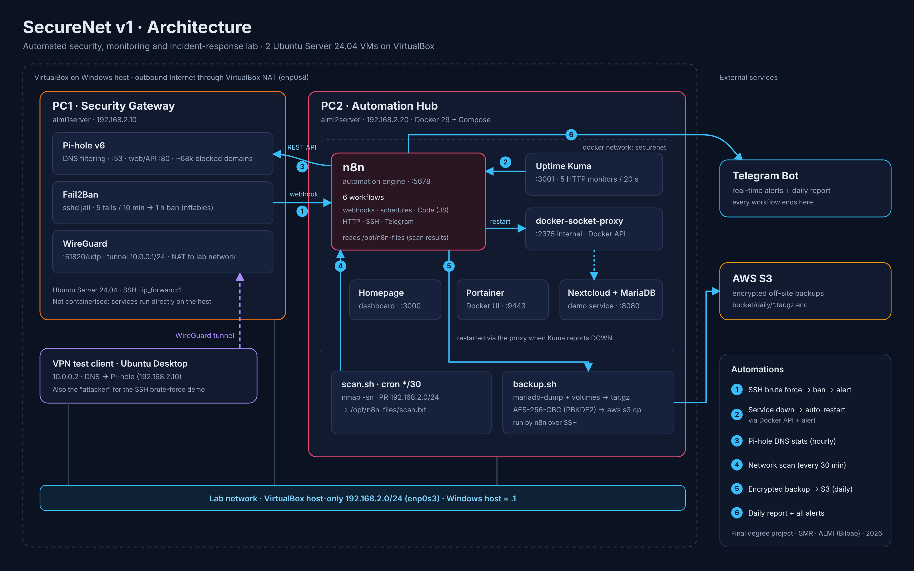
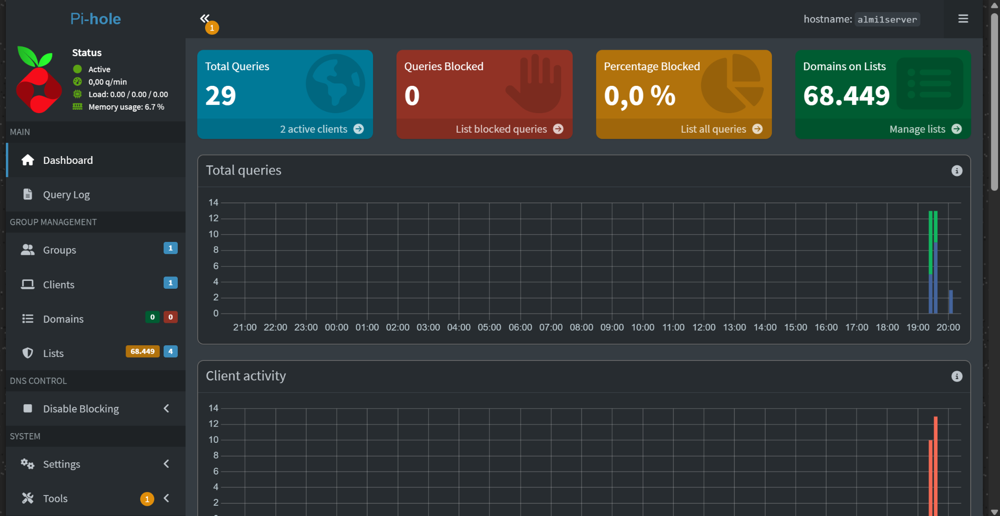

<div align="center">

# SecureNet

**Laboratorio automatizado de seguridad, monitorización y respuesta ante incidentes**

Trabajo de Fin de Grado (TFG) · Sistemas Microinformáticos y Redes (SMR) · ALMI, Bilbao · 2026


**Español** · [English](README.md)

</div>

---

SecureNet es un laboratorio de dos máquinas virtuales que **detecta incidentes y reacciona solo**: banea ataques de fuerza bruta SSH, reinicia servicios caídos, escanea la red, filtra DNS, envía copias cifradas a AWS y lo notifica todo por Telegram en tiempo real.

Este repositorio es la **v1 archivada**, tal y como se entregó y evaluó en febrero de 2026: archivos de configuración reales (sin secretos), los seis workflows de n8n exportados del sistema en funcionamiento, capturas, evidencias sacadas de los logs y una revisión de seguridad honesta hecha después de la entrega.



## Qué hace

| # | Automatización | Disparador | Qué ocurre |
|---|---|---|---|
| 1 | **Respuesta ante intrusiones** | Fuerza bruta SSH contra el gateway | Fail2Ban banea la IP (nftables) y llama a un webhook de n8n → alerta en Telegram |
| 2 | **Autorrecuperación de servicios** | Uptime Kuma detecta un servicio caído | n8n filtra duplicados, reinicia el contenedor por la API de Docker y avisa de la caída y la recuperación |
| 3 | **Visibilidad DNS** | Cada hora | n8n inicia sesión en la API REST de Pi-hole v6 (SID + CSRF) y envía estadísticas de consultas y bloqueos |
| 4 | **Descubrimiento de red** | Cada 30 min | Escaneo ARP con `nmap` → n8n extrae IP, MAC y fabricante → Telegram |
| 5 | **Copias cifradas fuera del sitio** | Diario | n8n ejecuta `backup.sh` por SSH: volcado de MariaDB y volúmenes Docker → AES-256 (PBKDF2) → AWS S3 |
| 6 | **Informe diario** | Diario | Estado de Docker (por API), escaneo y contadores en un único resumen de Telegram |

Además, una **VPN WireGuard** hacia la red del laboratorio y un panel **Homepage** con acceso a todos los servicios.

## Funcionando

| Workflow de autorrecuperación (n8n) | Alertas reales en Telegram |
|---|---|
|  |  |

| Uptime Kuma | Pi-hole v6 |
|---|---|
|  |  |

| Panel Homepage | Contenedores (Portainer) |
|---|---|
|  |  |

Más capturas en [`assets/screenshots`](assets/screenshots) y por workflow en [docs/04-workflows.md](docs/04-workflows.md).

## Arquitectura resumida

| Máquina | Rol | Ejecuta |
|---|---|---|
| **PC1** `192.168.2.10` | Gateway de seguridad | Pi-hole v6 · Fail2Ban · WireGuard (directamente sobre Ubuntu) |
| **PC2** `192.168.2.20` | Centro de automatización | Docker: n8n · Uptime Kuma · docker-socket-proxy · Homepage · Portainer · Nextcloud + MariaDB |
| **Cliente** `10.0.0.2` | Cliente VPN / atacante | Ubuntu Desktop para las pruebas de VPN y la demo de fuerza bruta |

Las dos VMs comparten una **red solo-anfitrión** de VirtualBox (`192.168.2.0/24`) para el tráfico interno y salen a Internet por un **adaptador NAT**, así que el laboratorio funciona igual en clase que en casa. Detalles en [docs/01-architecture.md](docs/01-architecture.md).

## Evidencias del sistema real

- **9 baneos reales** registrados por Fail2Ban entre el 23 y el 27 de febrero de 2026, incluido un ataque automatizado de **57 inicios de sesión SSH fallidos en tres oleadas en un minuto**, cada una baneada en menos de un segundo.
- **~9.600 comprobaciones** guardadas por Uptime Kuma desde el 10 de febrero de 2026: **81 caídas detectadas y 84 recuperaciones** registradas en los cinco servicios monitorizados.
- Alertas de Telegram de intrusiones, caídas, recuperaciones, escaneos e informes diarios (ver [docs/06-testing-and-evidence.md](docs/06-testing-and-evidence.md)).

## Revisión de seguridad posterior a la entrega

Después de la evaluación volví a auditar el sistema en funcionamiento, archivo por archivo, como si fuera de otra persona. La revisión encontró **13 bugs funcionales y 8 debilidades de seguridad**. Por ejemplo: el escáner nunca comparaba con los dispositivos conocidos, los contadores del informe diario no se podían incrementar, el backup siempre informaba de éxito y los webhooks de n8n aceptaban peticiones sin autenticar capaces de reiniciar contenedores.

Cada hallazgo, su causa raíz y la solución prevista están en [docs/08-security-review.md](docs/08-security-review.md). Son el punto de partida de SecureNet v2.

## Estructura del repositorio

```
.
├── assets/                 diagrama de arquitectura + capturas
├── configs/
│   ├── pc1-gateway/        netplan, Fail2Ban, WireGuard, Pi-hole, sysctl
│   └── pc2-automation-hub/ docker-compose, .env.example, Homepage, netplan, crontab
├── docs/                   arquitectura, instalación, workflows, backups, pruebas, errores, auditoría
├── scripts/                scan.sh (nmap) · backup.sh (volcado + cifrado + S3)
└── workflows/              los 6 workflows de n8n (+1 antiguo) exportados del sistema real
```

## Documentación

La documentación técnica detallada está en inglés:

1. [Arquitectura y diseño de red](docs/01-architecture.md)
2. [PC1 · Gateway de seguridad](docs/02-pc1-security-gateway.md)
3. [PC2 · Centro de automatización](docs/03-pc2-automation-hub.md)
4. [Workflows de n8n](docs/04-workflows.md)
5. [Copias de seguridad cifradas](docs/05-backups.md)
6. [Pruebas y evidencias](docs/06-testing-and-evidence.md)
7. [Registro de errores y lecciones aprendidas](docs/07-troubleshooting-log.md)
8. [Revisión de seguridad posterior a la entrega](docs/08-security-review.md)

## Qué aprendí

- Diseñar una **red portable** (solo-anfitrión + NAT) en lugar de depender del router del aula.
- Integrar herramientas mediante **webhooks y APIs REST** (sesiones de Pi-hole v6, API de Docker, Telegram).
- Aplicar **mínimo privilegio** a la automatización: n8n reinicia contenedores a través de un proxy del socket en lugar de montar el socket de Docker.
- **Persistencia y secretos** en Docker: volúmenes, permisos, una clave de cifrado fija para n8n.
- Depurar fallos reales: más de 50 incidencias documentadas en el [registro de errores](docs/07-troubleshooting-log.md).
- Y la más importante: **una funcionalidad no está terminada hasta que puedes demostrar que funciona**. La revisión posterior me enseñó más que la propia construcción.

## Tecnologías

Ubuntu Server 24.04 · VirtualBox · Docker 29 / Compose v5 · n8n 2.4 · Uptime Kuma 1 · Pi-hole v6 · Fail2Ban · WireGuard · nmap · Portainer CE · Homepage · Nextcloud 29 · MariaDB 11 · AWS CLI v2 / S3 · OpenSSL · Telegram Bot API

## Notas

- **Secretos:** todas las contraseñas, claves, tokens e identificadores se han eliminado o sustituido por marcadores (`<...>`, `${...}`). Los reales nunca se han subido.
- **Imágenes de las VMs** (`.ova`, ~10 GB): no se incluyen; la configuración de este repositorio basta para reconstruir el laboratorio.
- **Estado:** la v1 está congelada. Las mejoras se hacen en SecureNet v2.

## Autor

**Jon Revillas** · [GitHub @JRevii](https://github.com/JRevii)

Licencia [MIT](LICENSE).
