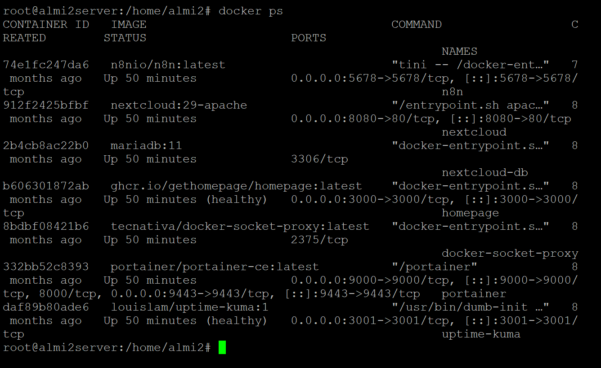
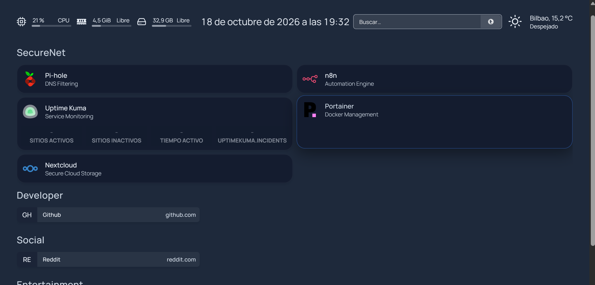

# 3 · PC2 · Automation hub

PC2 (`almi2server`, `192.168.2.20`) runs every application service in Docker, defined in a single Compose file: [`configs/pc2-automation-hub/docker-compose.yml`](../configs/pc2-automation-hub/docker-compose.yml) (on the server: `/root/securenet/docker-compose.yml`).



## Services

| Container | Image | Port | Role |
|---|---|---|---|
| `n8n` | `n8nio/n8n` (2.4.4) | 5678 | Automation engine: webhooks, schedules, Code nodes, SSH, Telegram |
| `uptime-kuma` | `louislam/uptime-kuma:1` | 3001 | Availability monitoring, sends webhooks to n8n |
| `docker-socket-proxy` | `tecnativa/docker-socket-proxy` | 2375 (internal) | Limited Docker API for n8n (`CONTAINERS=1`, `POST=1`) |
| `homepage` | `ghcr.io/gethomepage/homepage` | 3000 | Dashboard with links and system widgets |
| `portainer` | `portainer/portainer-ce` | 9000 / 9443 | Docker management UI |
| `nextcloud` | `nextcloud:29-apache` | 8080 | Example service protected by the lab (outage demos) |
| `nextcloud-db` | `mariadb:11` | — | Nextcloud database |

All services use `restart: unless-stopped` and the shared bridge network `securenet`.

## Key design decisions

### n8n never touches the Docker socket

Restarting containers from n8n needs the Docker API, but mounting `/var/run/docker.sock` inside n8n would give it full control of the host. Instead n8n calls **docker-socket-proxy**, an HAProxy that only forwards the API sections enabled by environment variables:

```bash
# from inside the n8n container
wget -qO- http://docker-socket-proxy:2375/_ping                                  # OK
wget -qO- --post-data='' http://docker-socket-proxy:2375/containers/homepage/restart
```

(n8n's image uses BusyBox `wget`, which does not support `--method=POST`; `--post-data=''` does the job.)

> v1 limitation: `POST=1` allows *any* POST on the containers API, including creating containers. See [security review](08-security-review.md).

### Persistent and recoverable n8n

- Workflows and credentials live in the external volume `securenet_n8n_data`, declared `external: true` so `docker compose down` never deletes it.
- `N8N_ENCRYPTION_KEY` is fixed. When it changed by accident, n8n could no longer decrypt the saved credentials (`Credential … does not exist`) and the Telegram credential had to be recreated.
- The volume must be owned by UID 1000 (`node`); otherwise n8n crash-loops with `EACCES`. Fix used:
  ```bash
  docker run --rm -u root -v securenet_n8n_data:/data alpine sh -c "chown -R 1000:1000 /data"
  ```

### Files shared with n8n

n8n can only read files under `/home/node/.n8n-files`. The host folder `/opt/n8n-files` is bind-mounted there, and `scan.sh` writes its results to `/opt/n8n-files/scan.txt`.

## Host-level jobs

| What | Where | Schedule |
|---|---|---|
| Network scan (`nmap -sn -PR 192.168.2.0/24`) | [`scripts/scan.sh`](../scripts/scan.sh) → `/opt/securenet/scan.sh` | root crontab, `*/30 * * * *` |
| Encrypted backup to S3 | [`scripts/backup.sh`](../scripts/backup.sh) → `/opt/securenet/backup.sh` | triggered daily by n8n over SSH |

A dedicated user `securenet-backup` (member of the `docker` group) runs the backup script when n8n connects over SSH.

## Homepage dashboard



Config in [`configs/pc2-automation-hub/homepage/`](../configs/pc2-automation-hub/homepage): service cards for Pi-hole, n8n, Uptime Kuma, Portainer and Nextcloud, plus resource, clock, search and weather widgets and a custom dark CSS theme.

## Rebuild PC2 (summary)

```bash
curl -fsSL https://get.docker.com | sh
docker volume create securenet_n8n_data
sudo mkdir -p /opt/n8n-files /opt/securenet && sudo cp scripts/*.sh /opt/securenet/
mkdir -p ~/securenet && cp -r configs/pc2-automation-hub/{docker-compose.yml,homepage} ~/securenet/
cp configs/pc2-automation-hub/.env.example ~/securenet/.env   # fill in real values
cd ~/securenet && docker compose up -d
# then import the JSON files from workflows/ into n8n and create the Telegram / SSH credentials
```
