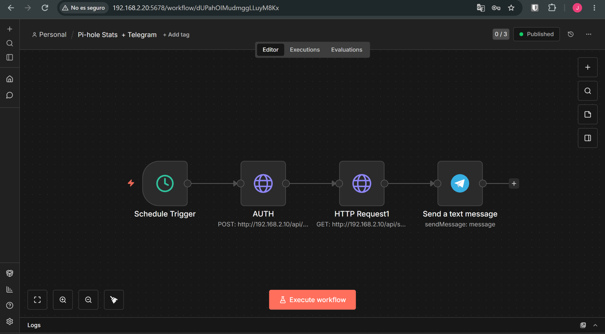
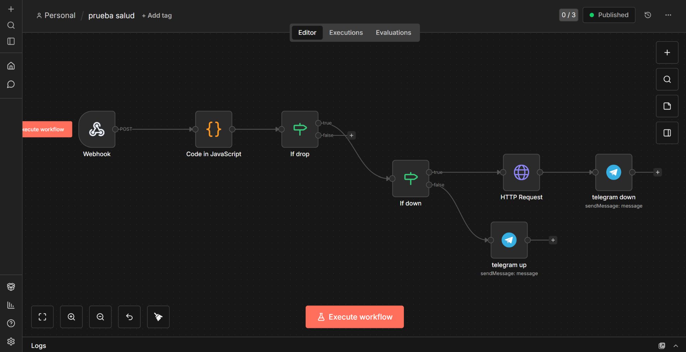
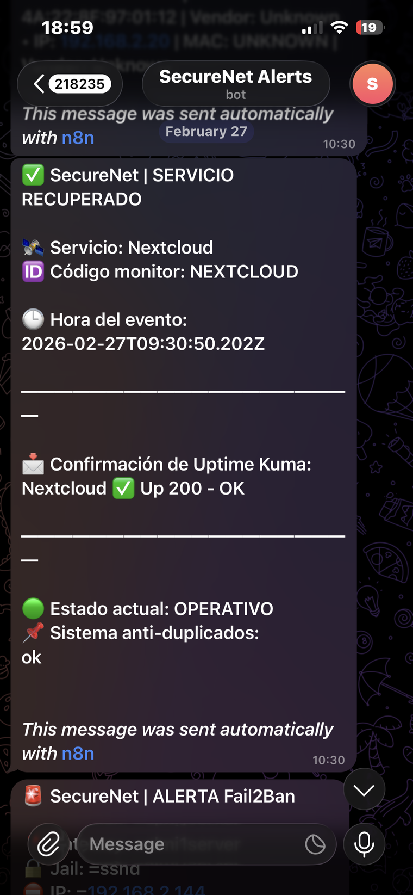
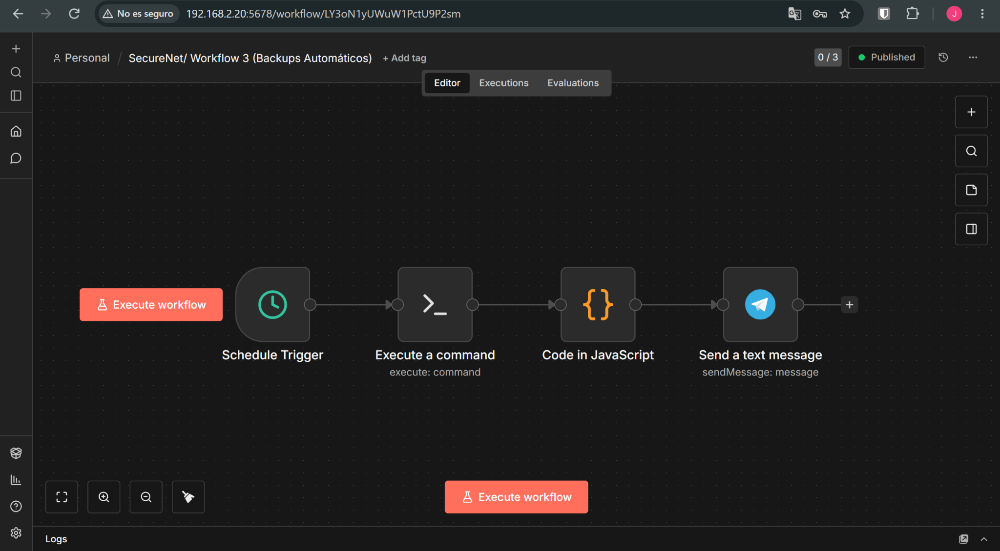
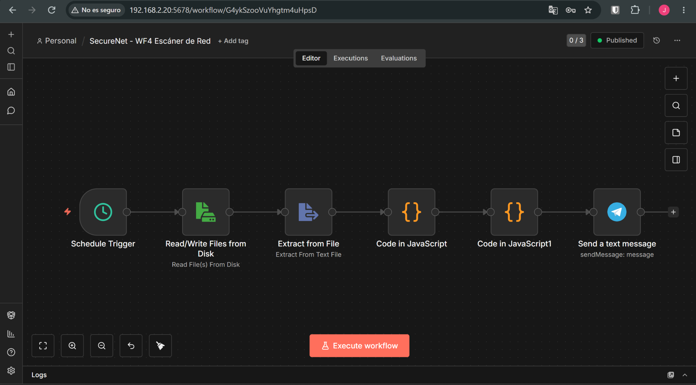
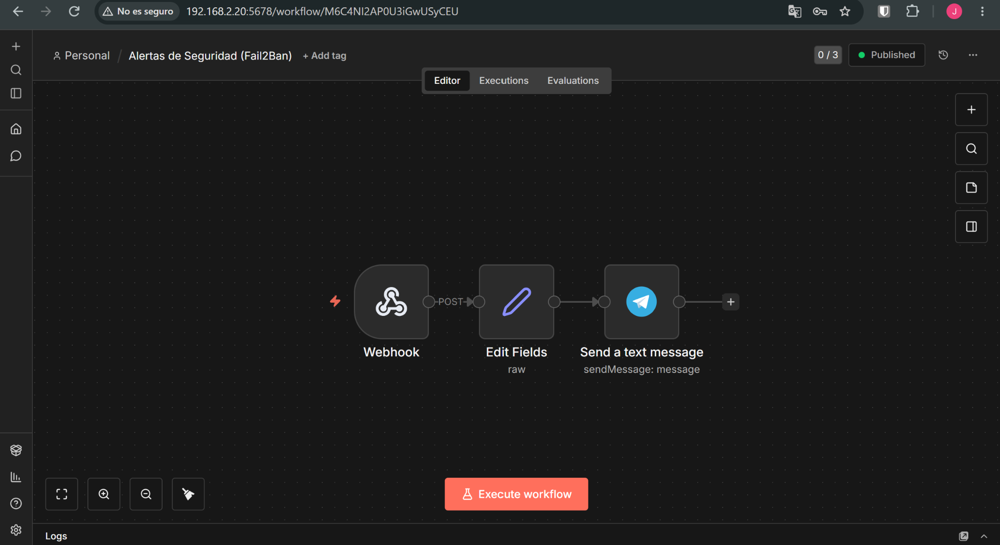
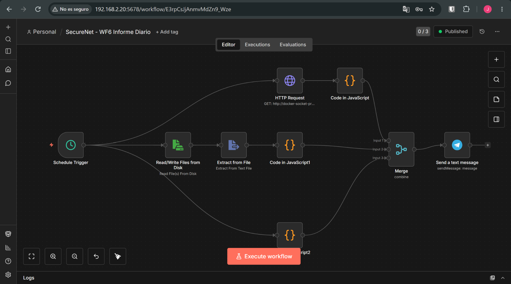

# 4 · n8n workflows

Six workflows run SecureNet (plus one legacy version kept for reference). The JSON files in [`/workflows`](../workflows) were exported from the live n8n 2.4.4 instance; the Telegram chat ID, the Pi-hole password and credential IDs were replaced with placeholders.

To import: n8n → *Workflows* → *Import from file*, then attach your own **Telegram API** and **SSH** credentials and replace `<TELEGRAM_CHAT_ID>` / `<PIHOLE_WEB_PASSWORD>`.

| # | Workflow | File | Trigger |
|---|---|---|---|
| 1 | Pi-hole stats | [`01-pihole-stats.json`](../workflows/01-pihole-stats.json) | every hour |
| 2 | Self-healing (Uptime Kuma) | [`02-auto-recovery-uptime-kuma.json`](../workflows/02-auto-recovery-uptime-kuma.json) | webhook `POST /webhook/kuma-alert` |
| 3 | Encrypted backups to S3 | [`03-encrypted-backups-s3.json`](../workflows/03-encrypted-backups-s3.json) | daily |
| 4 | Network scanner | [`04-network-scanner.json`](../workflows/04-network-scanner.json) | every 30 min |
| 5 | Fail2Ban alerts | [`05-fail2ban-alerts.json`](../workflows/05-fail2ban-alerts.json) | webhook `POST /webhook/fail2ban` |
| 6 | Daily report | [`06-daily-report.json`](../workflows/06-daily-report.json) | daily |
| — | Legacy Kuma alert (first version, unused) | [`legacy-uptime-kuma-basic-alert.json`](../workflows/legacy-uptime-kuma-basic-alert.json) | webhook `POST /webhook/uptimekuma` |

---

## 1 · Pi-hole stats



`Schedule (1 h)` → `AUTH: POST /api/auth` → `GET /api/stats/summary` with `X-FTL-SID` / `X-FTL-CSRF` from the AUTH node → `Telegram`

The message reports total queries, blocked queries and percentage, active clients and domains on the blocklists.

Getting here took several attempts: the classic `api.php` endpoint is gone in v6, Bearer and Basic auth return `401`, and an *application password* is rejected by `/api/auth` (the web password is required). The node that logs in must be named exactly `AUTH` because the next node reads `$node["AUTH"].json.session.sid`.

## 2 · Self-healing services



`Webhook` → `Code` → `If drop` → `If down` → **true:** `HTTP POST restart` → `Telegram (incident)` · **false:** `Telegram (recovered)`

Each Uptime Kuma monitor has its own webhook notification with a custom body:

```json
{ "msg": "{{msg}}", "monitor_code": "HOMEPAGE" }
```

The **Code node** (JavaScript) does the heavy lifting:

- Normalises the payload (Kuma can send JSON or a form-encoded string).
- Detects the state from the message: `[🔴 Down]` → `DOWN`, `[✅ Up]` / `[🟢 Up]` → `UP`.
- Maps the monitor code to a container: `HOMEPAGE → homepage`, `PORTAINER → portainer`, `KUMA → uptime-kuma`, `N8N → n8n`.
- **De-duplicates** with workflow static data: the signature `monitor|status` is ignored if it was seen in the last 120 s (DOWN) or 45 s (UP). Kuma retries and duplicated notifications were sending 2–3 identical alerts before this.
- Never drops a DOWN silently: if there is no mapping it emits `status: ERROR`.

For a DOWN event n8n calls `POST http://docker-socket-proxy:2375/containers/{container}/restart?t=5` and sends:

```
🚨 SecureNet | INCIDENTE DETECTADO
🛰️ Servicio: Homepage   📦 Contenedor: homepage
🛠️ Acción automática ejecutada: 🔁 Restart del contenedor vía Docker API
```

When Kuma sees the service back up, the UP branch sends **SERVICIO RECUPERADO**.

| Telegram | |
|---|---|
|  |  |

Known issues in v1 (unmapped monitors reported as "recovered", n8n mapped to restart itself…) → [security review](08-security-review.md).

## 3 · Encrypted backups to S3



`Schedule (daily)` → `SSH: /opt/securenet/backup.sh` (user `securenet-backup` on PC2) → `Code` (extracts the uploaded file name from stdout) → `Telegram`

The script is described in [05-backups.md](05-backups.md).

## 4 · Network scanner



`cron */30 scan.sh` writes `scan.txt` → `Schedule (30 min)` → `Read file` → `Extract text` → `Code: parse nmap` → `Code: summary` → `Telegram`

The parser splits the nmap output on `Nmap scan report for`, then extracts IP (`hostname (ip)` or bare IP), MAC address and vendor for each host.

> Reading files from Code nodes with `require('fs')` is blocked by n8n, so the file is read with the native *Read/Write Files from Disk* node, and only from the allowed folder `/home/node/.n8n-files`.

v1 limitation: the workflow reports **every** host found, not only new ones (see review).

## 5 · Fail2Ban alerts



`Webhook POST /webhook/fail2ban` → `Edit Fields (normalise)` → `Telegram`

The Set node normalises the payload because it arrives either at `$json.body.*` or `$json.*` depending on test vs production mode:

```js
$json.body?.ip ?? $json.ip ?? 'N/A'
```


The `=` shown before every value is a v1 bug explained in the review.

## 6 · Daily report



Three branches run in parallel and are merged by position:

1. `GET docker-socket-proxy:2375/containers/json?all=1` → Code: total, running, stopped (with names), healthy, unhealthy.
2. `Read scan.txt` → Code: number of hosts found.
3. Code: read and reset daily counters (Fail2Ban bans, Kuma outages) from workflow static data.

→ `Merge` → `Telegram`


> The Docker API returns one n8n item per container, so the code uses `$input.all().map(i => i.json)` instead of treating the input as an array (the original bug was `containers.filter is not a function`).

## Webhooks: test vs production

A lesson repeated in several workflows: n8n's `/webhook-test/...` URL only works while the editor is listening for a test event. Fail2Ban and Uptime Kuma must point to the production URL `/webhook/...`, and the workflow must be active.
