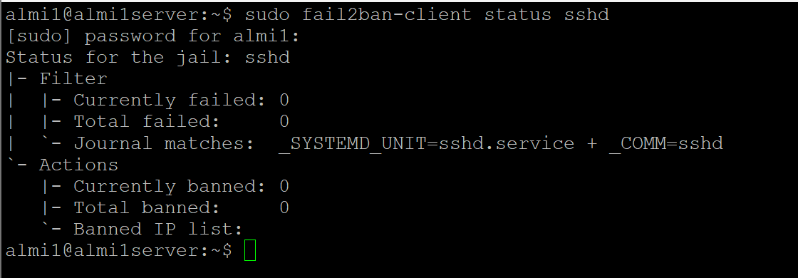
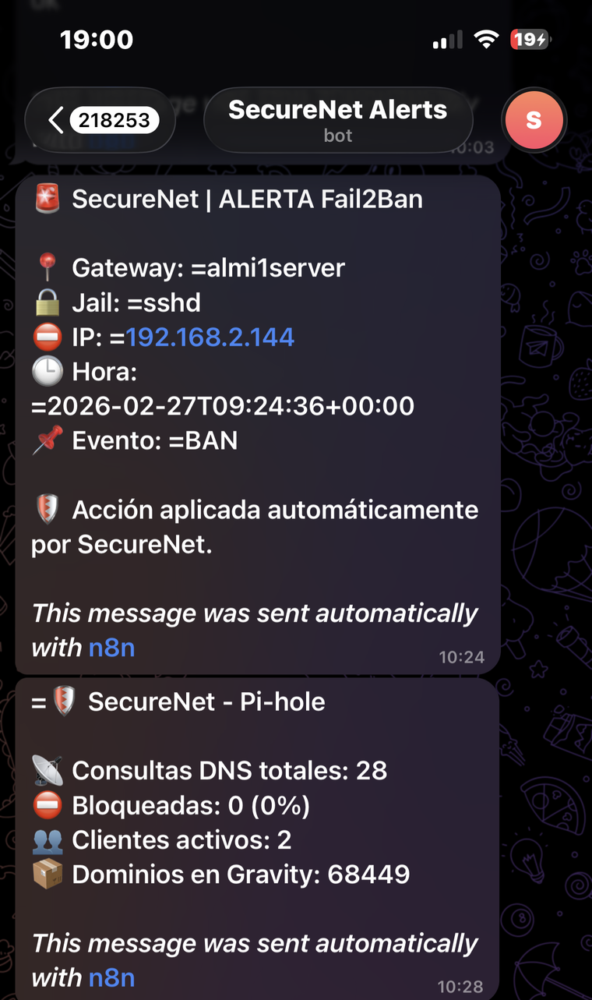
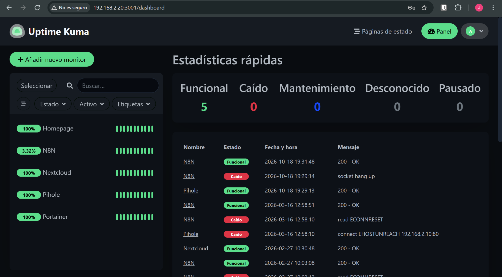
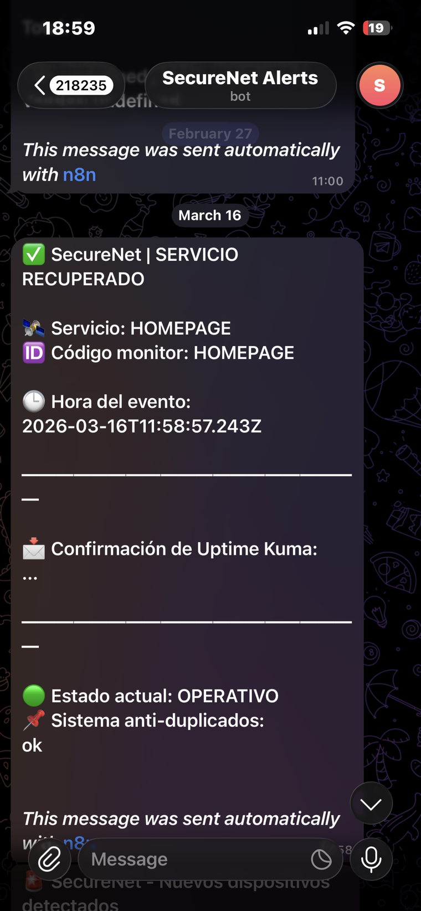
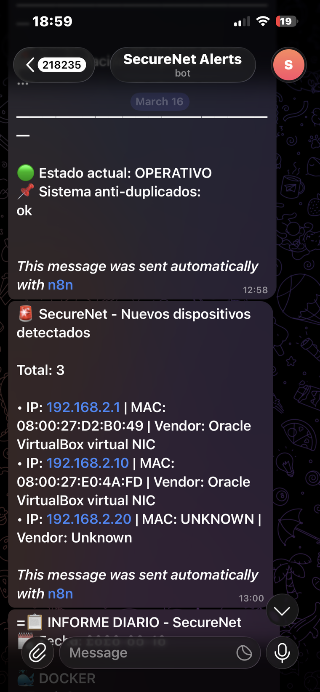
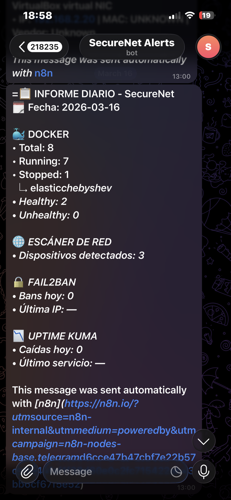
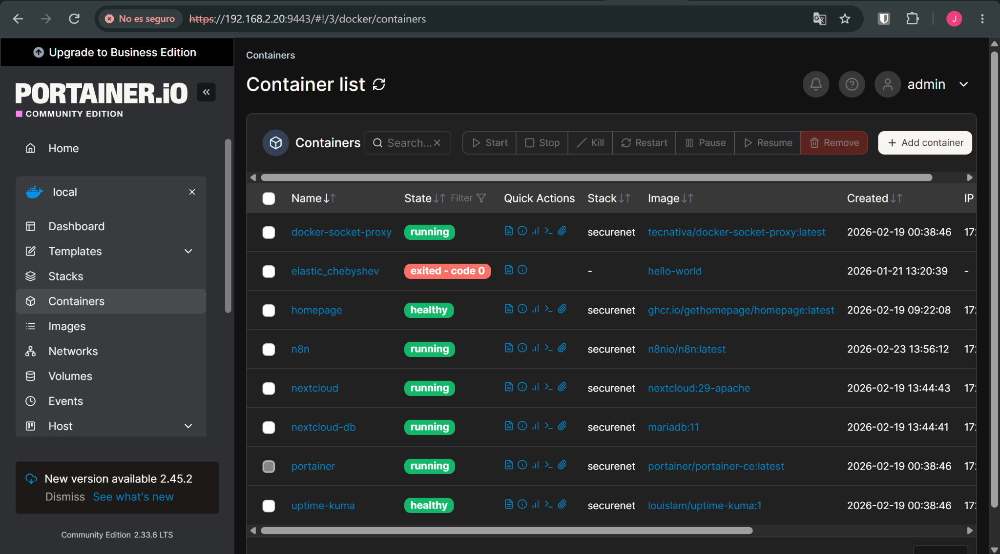
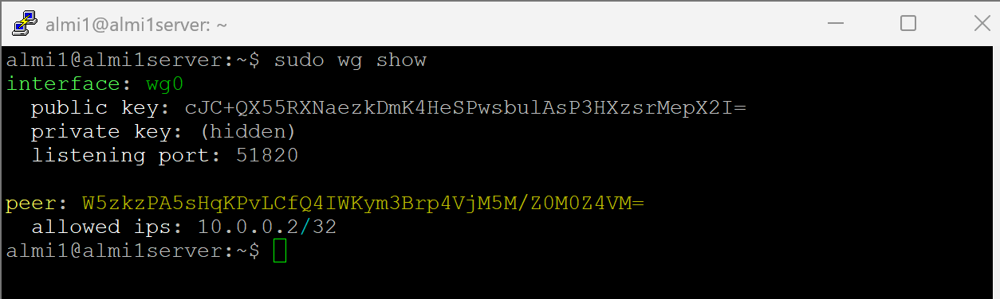

# 6 · Testing and evidence

Everything below comes from the real system: the Fail2Ban log on PC1, the Uptime Kuma database on PC2, the n8n workflows and the Telegram chat. Private lab IPs are shown; MAC addresses of devices that did not belong to the lab were left out.

## Summary

| Test | Method | Result | Evidence |
|---|---|---|---|
| SSH brute force | Repeated failed logins from lab machines, including an automated attack | ✅ 9 bans between 23–27 Feb 2026; alert on Telegram | Fail2Ban log, Telegram |
| Service outage + self-healing | `docker stop homepage` / Nextcloud while Kuma monitors | ✅ DOWN detected, container restarted by n8n, UP reported | Kuma history, Telegram |
| Pi-hole stats via API | Scheduled workflow with session auth | ✅ stats delivered | Telegram |
| Network scan | cron + nmap ARP scan, parsed by n8n | ✅ hosts with IP/MAC/vendor delivered | Telegram |
| Daily report | Scheduled / manual run | ✅ Docker + scan + counters delivered (counters always 0, see review) | Telegram |
| Encrypted backup | Manual run of `backup.sh` and via n8n SSH | ✅ upload to S3 confirmed with `aws s3 ls` (Feb 2026) | backup log |
| WireGuard | Client up, handshake, ping to `10.0.0.1` | ✅ tunnel up (scope limits, see review) | `wg show` |
| Persistence | Recreate containers | ✅ workflows and monitors survive `docker compose down/up` | volumes |

## 1 · SSH brute force → Fail2Ban → Telegram

Ban history from `/var/log/fail2ban.log`:

| Date (UTC) | Source | Event |
|---|---|---|
| 2026-02-23 07:36 | 192.168.2.138 | Ban (5 failures) |
| 2026-02-23 07:46 | 192.168.2.138 | Ban |
| 2026-02-23 07:51 | 192.168.2.138 | Ban restored after Fail2Ban restart |
| 2026-02-23 07:52 | 192.168.2.138 | Ban |
| 2026-02-23 07:56 | 192.168.2.143 | Ban |
| 2026-02-23 08:04 | 192.168.2.143 | Ban |
| 2026-02-27 09:24 | 192.168.2.144 | Ban → Telegram alert |
| 2026-02-27 09:41:39 | 192.168.2.144 | Ban — wave 1: 29 failed logins in 3 s |
| 2026-02-27 09:42:12 | 192.168.2.144 | Ban — wave 2: 14 failed logins in 3 s |
| 2026-02-27 09:42:44 | 192.168.2.144 | Ban — wave 3: 14 failed logins in 2 s |

The 27 Feb attack (57 failed logins in one minute) came from the Ubuntu test client (`.144`, a VirtualBox NIC). Each wave was banned within about one second of starting.





## 2 · Outage → automatic restart → recovery

Uptime Kuma stored **~9,600 checks** between 10 Feb and 16 Mar 2026 (plus the October restore), with these state changes:

| Monitor | Outages detected | Recoveries |
|---|---|---|
| Homepage | 43 | 44 |
| Portainer | 14 | 14 |
| Pi-hole | 12 | 12 |
| n8n | 11 | 12 |
| Nextcloud | 1 | 2 |

Most Homepage outages were deliberate tests (`docker stop homepage` repeated many times while tuning the workflow, visible in the shell history).



| Recovery alerts | Scan + recovery |
|---|---|
|  |  |

Manual test of the workflow without stopping anything:

```bash
curl -s -X POST http://192.168.2.20:5678/webhook/kuma-alert -H "Content-Type: application/json" \
  -d '{"msg":"[Homepage] [🔴 Down] connect ECONNREFUSED 192.168.2.20:3000","monitor_code":"HOMEPAGE"}'
```

## 3 · Daily report



## 4 · Containers and VPN





## Live connectivity check (October 2026, after restoring the VMs)

Every endpoint answered from both machines and from inside the n8n container:

```
http://192.168.2.10/admin/            302   Pi-hole UI
http://192.168.2.10/api/auth          401   Pi-hole API (needs session, as expected)
http://192.168.2.20:3000              200   Homepage
http://192.168.2.20:3001              302   Uptime Kuma
http://192.168.2.20:5678/healthz      200   n8n
http://192.168.2.20:8080/status.php   200   Nextcloud
https://192.168.2.20:9443             200   Portainer
http://docker-socket-proxy:2375/_ping 200   from inside n8n
https://api.telegram.org              302   Internet via NAT
```
